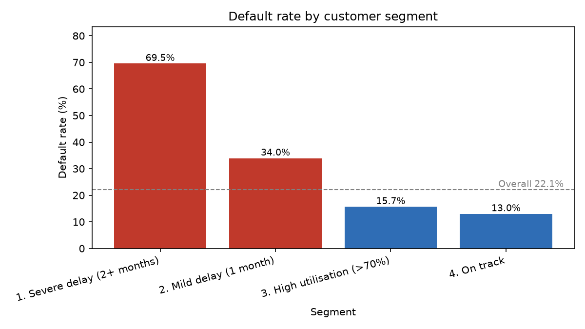
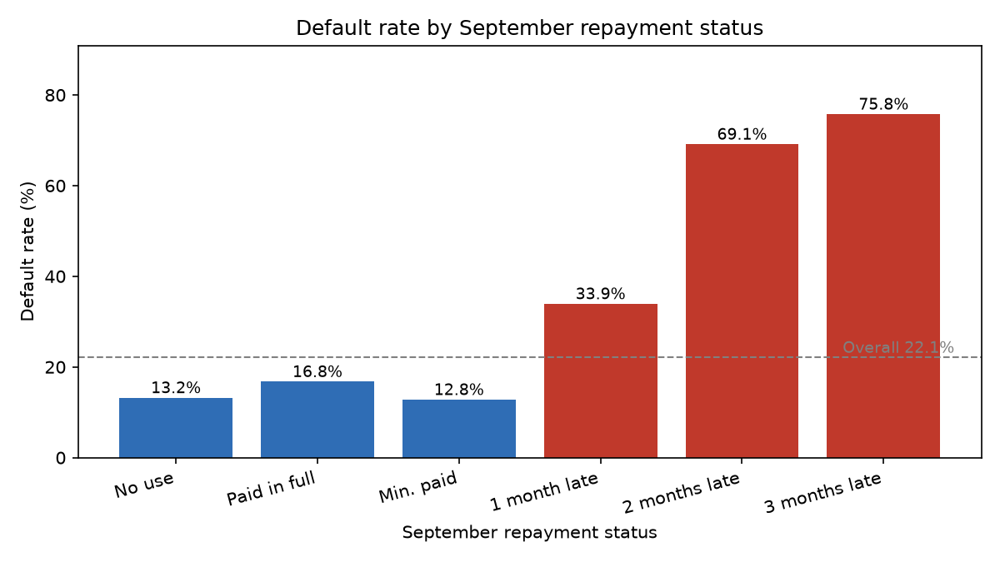
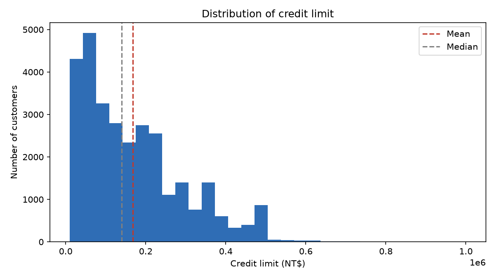

# Credit Card Default Risk Analysis

A personal project to practise the full data analysis workflow: clean data, model it, query it with SQL, calculate statistics, segment customers, build an Excel analysis and write up the findings for a business audience.

> **In one minute:** Using 30,000 credit card customers, I found that **late payment is the strongest warning sign of default**. Customers 1+ month late in September are 22.7% of customers but 51.7% of all defaulters (default rate 50.3% vs 13.8% for on-time customers). Lower credit limits also default more (36.1% under 50k vs 13.7% for 300k+). **Recommendation:** watch customers who are 1 month late and act at 2+ months late (69.6% default rate).
> Built with Python, SQL (SQLite) and Excel. Full write-up: [docs/insights_summary.md](docs/insights_summary.md).

**Data:** public UCI "Default of Credit Card Clients" dataset (Yeh, I-C., 2009): 30,000 credit card customers of a bank in Taiwan, April to September 2005. This is public data, not employer data.

**Tools:** Python (pandas, matplotlib), SQL (SQLite), Excel, Git and GitHub.

## Business question

Which customers are most likely to default next month, and what should a lender do about it?

## What I did

1. **Cleaned the data** (Python, pandas): checked missing values and duplicates, renamed columns, merged undocumented education and marriage codes into "Others".
2. **Built a small database** (SQLite): one wide table reshaped into a `customers` table, a `monthly_statements` table (one row per customer per month) and lookup tables, so JOINs are natural.
3. **Wrote SQL**: JOIN, GROUP BY, HAVING, CASE, subqueries, UNION ALL, a CTE, and window functions (LAG for month-over-month change, DENSE_RANK with PARTITION BY).
4. **Created rule-based customer segments** and KPIs (Python).
5. **Ran basic statistics** (Python): mean, median and standard deviation, outliers with the IQR rule, correlation with default, and a two-proportion z-test.
6. **Built an Excel analysis**: pivot table, XLOOKUP, IF, COUNTIFS, SUMIFS and a chart (`excel/credit_default_excel_analysis.xlsx`).
7. **Wrote an insights summary** for a business audience (`docs/insights_summary.md`).

## Key findings

Overall default rate: **22.12%** (6,636 of 30,000 customers).

| Segment                                    | Customers | Default rate | Share of all defaulters |
| ------------------------------------------ | --------- | ------------ | ----------------------- |
| Severe delay (2+ months late in September) | 3,130     | 69.55%       | 32.8%                   |
| Mild delay (1 month late)                  | 3,688     | 33.95%       | 18.9%                   |
| High utilisation (over 70%, not late)      | 6,966     | 15.72%       | 16.5%                   |
| On track                                   | 16,216    | 13.02%       | 31.8%                   |

- **Repayment delay is the strongest signal.** Customers late in September are 22.7% of the base but 51.7% of all defaulters. Their default rate is 50.29%, against 13.83% for on-time customers. A two-proportion z-test gives z = 63.8, so the gap is very unlikely to be chance.
- **Lower credit limits default more:** 36.07% for limits under 50k vs 13.68% for 300k and above.
- **Higher credit limits did not protect late payers:** late payers with an above-average limit still defaulted at 68.95%.
- **Correlation with default:** September repayment status is the strongest (0.325). Credit limit is weakly negative (-0.154).
- **Outliers:** 8.0% of September bills are above the IQR upper limit. They are real large bills, so I kept them and compared medians as well as means.
- Average monthly bill rose every month from April (38,872) to September (51,223).





## How well do the rules work?
The segments are simple rules, so I measured how well they find defaulters (baseline default rate: 22.12%).

| Rule | Customers flagged | Defaulters caught | Hit rate (precision) | Share of all defaulters caught (recall) | Times higher than baseline |
|---|---|---|---|---|---|
| 2+ months late in September | 3,130 | 2,177 | 69.6% | 32.8% | 3.14 |
| 1+ month late in September | 6,818 | 3,429 | 50.3% | 51.7% | 2.27 |
| Late, or utilisation over 70% | 13,784 | 4,524 | 32.8% | 68.2% | 1.48 |

A stricter rule is right more often but finds fewer defaulters. That is why I recommend two levels: watch customers 1 month late, and act at 2+ months late. About a third of defaulters were still "On track" in September, so a predictive model could find more; I have not built one.

## Recommendations

- Monitor customers who are 1 or more months late in the latest month.
- Be careful with low credit limits for customers with weak repayment history.
- Review high-utilisation customers, but treat them as lower priority than late payers.
- Use these rules as a screening tool, not as proof of cause. Full write-up: [docs/insights_summary.md](docs/insights_summary.md).

## Limitations

- One bank, Taiwan, 2005: not representative of today's customers.
- Only 6 months of history.
- Repayment codes -2 and 0 are not documented; I assumed -2 = no credit use and 0 = paid the minimum.
- 31.8% of defaulters are in the "On track" segment, so simple rules miss many defaulters.
- Findings show correlation, not causation. The segments are simple rules, not a predictive model.

## Project structure

```
credit-default-analysis/
|-- src/                  Python scripts (cleaning, database, SQL runner, KPIs, charts, statistics, exports)
|-- sql/                  SQL queries (overview, trends/window functions, HAVING/subquery/UNION)
|-- results/              Charts and summary tables produced by the scripts
|-- excel/                Excel analysis (pivot table, XLOOKUP, SUMIFS, chart)
|-- docs/                 Insights summary for a business audience
|-- data_dictionary.md    Column meanings and data quality notes
|-- requirements.txt      Python packages
```

(`data/` is not stored in the repo. Download the dataset as described below.)

## How to run

```
python -m venv
```
