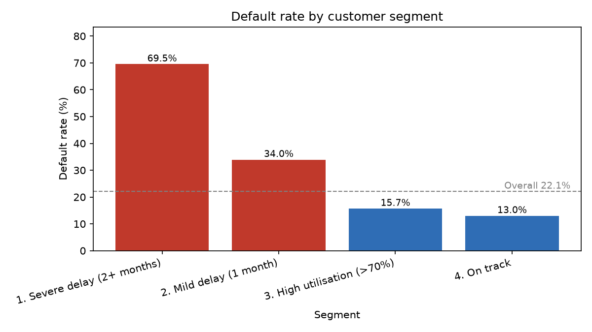
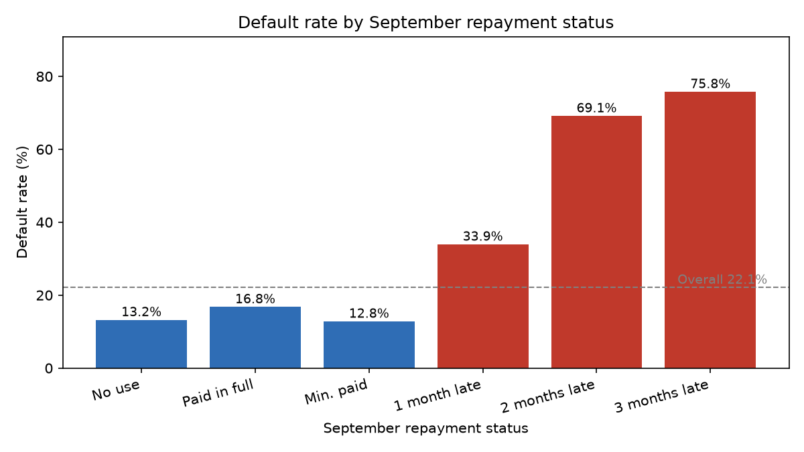

# Credit Card Default Risk Analysis

A personal project to practise the full data analysis workflow: clean data, model it, query it with SQL, segment customers, calculate KPIs and chart the findings.

**Data:** public UCI "Default of Credit Card Clients" dataset (Yeh, I-C., 2009): 30,000 credit card customers of a bank in Taiwan, April to September 2005. This is public data, not employer data.

## Business question
Which customers are most likely to default next month, and what should a lender do about it?

## What I did
1. **Cleaned the data** (Python, pandas): checked missing values and duplicates, renamed columns, merged undocumented education and marriage codes into "Others".
2. **Built a small database** (SQLite): one wide table reshaped into a `customers` table, a `monthly_statements` table (one row per customer per month) and lookup tables, so JOINs are natural.
3. **Wrote SQL** with JOINs, GROUP BY, CASE, a CTE, and window functions (LAG for month-over-month change, DENSE_RANK for ranking).
4. **Created rule-based customer segments** and KPIs (Python).
5. **Made charts** (matplotlib).

## Key findings
Overall default rate: **22.12%** (6,636 of 30,000 customers).

| Segment | Customers | Default rate | Share of all defaulters |
|---|---|---|---|
| Severe delay (2+ months late in September) | 3,130 | 69.55% | 32.8% |
| Mild delay (1 month late) | 3,688 | 33.95% | 18.9% |
| High utilisation (over 70%, not late) | 6,966 | 15.72% | 16.5% |
| On track | 16,216 | 13.02% | 31.8% |

- **Repayment delay is the strongest signal.** Customers late in September are 22.7% of the base but 51.7% of all defaulters.
- **Low credit limits default more:** 36.07% for limits under 50k vs 13.68% for 300k+.
- **Higher utilisation goes with higher default**, but the effect is smaller than late payment.
- Average monthly bill rose every month from April (38,872) to September (51,223).




## Recommendations
- Monitor customers who are 1 or more months late in the latest month.
- Be careful with low credit limits for new customers with weak repayment history.
- Review high-utilisation customers, but treat them as lower priority than late payers.
- Use these rules as a screening tool, not as proof of cause.

## Limitations
- One bank, Taiwan, 2005: not representative of today's customers.
- Only 6 months of history.
- Repayment codes -2 and 0 are not documented; I assumed -2 = no credit use and 0 = paid the minimum.
- 31.8% of defaulters are in the "On track" segment, so simple rules miss many defaulters.
- Findings show correlation, not causation. The segments are simple rules, not a predictive model.

## How to run
```
python -m venv .venv
.venv\Scripts\activate.bat
pip install -r requirements.txt
```
Download the dataset from https://archive.ics.uci.edu/dataset/350/default+of+credit+card+clients and place the file in `data/raw/`. Then run:
```
python src\clean_data.py
python src\build_database.py
python src\run_sql.py sql\01_overview_and_segments.sql
python src\run_sql.py sql\02_trends_window_cte.sql
python src\segmentation_kpis.py
python src\make_charts.py
```

See `data_dictionary.md` for column meanings and data quality notes.